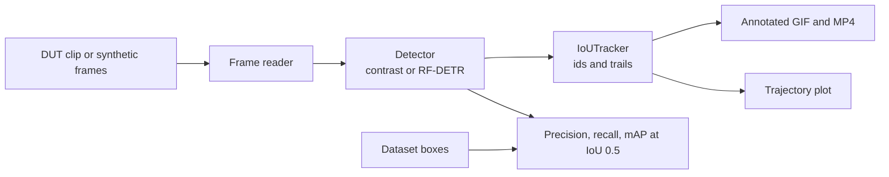
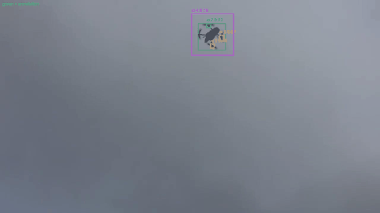
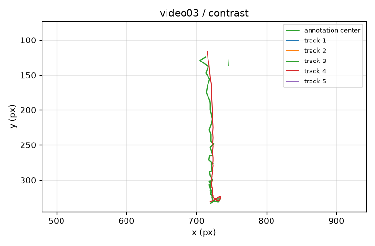

# open-cuas-tracker

Open-source drone detection and tracking for a week-1 demo that costs nothing to run.

[](https://colab.research.google.com/github/graboosky/open-cuas-tracker/blob/cursor/drone-detection-skeleton-cf13/notebooks/demo_colab.ipynb)

The badge above points at the branch that contains this skeleton, so it works before merge. After this pull request is merged, the permanent notebook is:

[](https://colab.research.google.com/github/graboosky/open-cuas-tracker/blob/development/notebooks/demo_colab.ipynb)

The development link 404s until the merge. The notebook tries the feature branch first and then `development`, so Run all still finds the code after the feature branch is deleted, once `development` has it.

**This is detection and tracking research. There is no effector.** The repository does not jam, spoof, intercept, guide, or otherwise engage an aircraft. It draws boxes on video.

## What it is

A small Python package that reads a clip, detects flying objects, keeps a track id and a trail, and writes an annotated GIF plus precision, recall and mAP@0.5 against the clip's own boxes.

The measured demo uses [DUT Anti-UAV](https://github.com/wangdongdut/DUT-Anti-UAV) `video03` (100 frames, 1280×720, one drone against cloud). The clip is downloaded at runtime from the public Hugging Face mirror [`aegean-ai/dut-anti-uav`](https://huggingface.co/datasets/aegean-ai/dut-anti-uav). It is not stored in git. The authors' repository and that mirror are Apache-2.0. See [docs/LICENSES.md](docs/LICENSES.md) before using the data in a product.

Two detectors share one interface:

| Detector | When to use it | Licence |
| --- | --- | --- |
| `contrast` (default for this demo) | Dark aircraft on a bright sky. No weights. This is what the numbers below were measured with. | Apache-2.0, this repository |
| `rfdetr` | Learned detector. Sizes `nano`, `small`, `medium`, `large` only. | Apache-2.0 code and those four checkpoints. COCO weights have **no drone class**, so recall is not claimed until you fine-tune. |

Ultralytics YOLOv5, YOLOv8 and YOLO11 are AGPL-3.0. `build_detector("yolov8")` raises. They are the wrong default if this code later ships in a closed product. An AGPL model can still be attached behind the same `Detector` protocol in a separate research process, if you accept the AGPL terms or buy a commercial licence from the vendor.

The tracker is `IoUTracker` in this repository (Apache-2.0): high-score boxes match first, then low-score boxes, which is the ByteTrack association idea. It is not a copy of [FoundationVision/ByteTrack](https://github.com/FoundationVision/ByteTrack) (MIT) or [abewley/sort](https://github.com/abewley/sort) (GPL-3.0). [supervision](https://github.com/roboflow/supervision) (MIT) and [roboflow/trackers](https://github.com/roboflow/trackers) (Apache-2.0) are the permissive libraries to swap in later.

## Quickstart

### Google Colab (free, no GPU required for the default demo)

1. Click the first **Open in Colab** badge at the top of this file (the feature-branch link, until merge).
2. If Colab asks before running a GitHub notebook, confirm.
3. Choose **Runtime → Run all**. Leave the runtime on CPU. A T4 is only useful if you later set `RUN_RFDETR` or `RUN_FINETUNE` to `True`.
4. Wait for the metrics printout and the GIF. The notebook downloads DUT `video03` (about 2 MB) from Hugging Face. No API key, no Google Drive, no account beyond Colab itself.

### This machine

```bash
python -m venv .venv
source .venv/bin/activate
pip install -r requirements.txt
python scripts/run_pipeline.py --video-id video03 --output runs/video03
```

Open `runs/video03/preview.gif` and `runs/video03/trajectory.png`. The command prints the metrics JSON. `runs/` is gitignored.

Offline, with no download and no claim that the square is a drone:

```bash
python scripts/run_pipeline.py --synthetic --output runs/synthetic
```

### Kaggle (free CPU or free GPU)

Create a notebook, turn **Internet** on, and leave the GPU off for the default demo. Run the notebook's first cell: it clones this repository. A free T4 is optional and only matters for the RF-DETR cells.

## Pipeline



## Results

Measured on 2026-10-31 on a CPU VM (`Linux-6.12.94+-x86_64-with-glibc2.39`), not on a Colab T4. FPS is processing speed. DUT does not publish the camera frame rate. The GIF plays at 8 fps so the motion is easy to see. Full JSON: [`docs/video03_metrics.json`](docs/video03_metrics.json), [`docs/video02_metrics.json`](docs/video02_metrics.json).

| Clip | What it is | Detector | Precision@0.5 | Recall@0.5 | mAP@0.5 | Detector FPS | End-to-end FPS |
| --- | --- | --- | --- | --- | --- | --- | --- |
| `video03` | 100 frames, 1280×720, drone on cloud. **Thresholds were chosen on this clip.** | `contrast` | 0.914 | 0.960 | 0.901 | 279.3 | 278.1 |
| `video02` | 83 frames, 1280×720, drone over a park and trees. Same settings, not retuned. | `contrast` | 0.000 | 0.000 | 0.000 | 359.9 | 358.3 |
| either clip | COCO-pretrained RF-DETR Nano has no drone class. | `rfdetr` | TBD – run notebook | TBD – run notebook | TBD – run notebook | TBD – run notebook | TBD – run notebook |

`video03` counts: 96 true positives, 9 false positives, 4 false negatives, 100 ground-truth boxes. Track id 4 is present on all 100 frames. Ids 1, 2, 3 and 5 last one or two frames and are fragments, mostly at the start.



Green boxes are the dataset annotations. Coloured boxes are tracks, with id, score and a trail.



`video02` is included because a fitted sky detector that only reports the clip it was tuned on would be misleading. On that landscape the same threshold locks onto dark trees and misses the aircraft: recall is zero. Do not quote the `video03` row as a general counter-UAS accuracy.

## Limitations

- The default detector is a dark-pixel blob detector, not a trained network. It assumes the aircraft is darker than about grey level 40 and that the background is not full of other dark objects.
- `expand=3` grows the dark core so it can overlap DUT's boxes, which include rotors and margin. That factor was selected on `video03`.
- One target, two short clips, no held-out test set, no cross-validation.
- No camera-motion compensation, no bird-versus-drone classifier, no infrared in the measured path.
- COCO RF-DETR / RT-DETR / YOLOX weights do not contain a drone label. Until a fine-tune, their drone recall should be treated as unknown.
- Small targets (the end of `video03` is about 25×22 px) are where this kind of system actually has to work. This demo does not solve that.
- No effector, and no plan to add one in this repository.

## Dataset and model licensing

The decision for this skeleton: **show the demo on DUT Anti-UAV, and keep the learned detector on Apache-2.0 RF-DETR Nano/Small/Medium/Large.** Drone-vs-Bird needs a research data agreement, so it is not used. MAVREC is CC-BY-4.0 and allows commercial use, but it is aerial footage of ground scenes, not drones as the thing to detect. Anti-UAV 300/410/600 code is MIT, but the data terms conflict across mirrors (Zenodo says MIT and then restricts the files; a Kaggle mirror says CC BY-NC-SA). Those sequences are research-only until the data owner states otherwise.

Details, sizes and links are in [docs/LICENSES.md](docs/LICENSES.md). Nothing in that table is a substitute for reading the licence or for legal advice.

Dataset bytes and weight files stay out of git. A fine-tune, if you turn it on in the notebook, writes checkpoints to Google Drive or to `runs/`, not to the repository.

## Roadmap

- EO/IR fusion, once a paired RGB and infrared set has terms that allow the product you actually want to ship.
- Small-target detection, aimed at objects well under 32×32 px.
- Passive optical sensor networks: several cameras, no emitting radar, shared tracks.

## Podsumowanie po polsku

**open-cuas-tracker** to publiczny szkielet wykrywania i śledzenia dronów na obrazie z kamery. Demo ma działać za darmo w Google Colab (wystarczy CPU; darmowy T4 jest potrzebny tylko do modelu uczonego), na Kaggle albo lokalnie.

Klip demo to `video03` z DUT Anti-UAV (Apache-2.0, pobierany przy uruchomieniu, nie trafia do gita). Domyślny detektor na ten pomiar to prosty detektor ciemnego obiektu na jasnym niebie — kod z tego repozytorium, bez wag. Na tym jednym klipie, na CPU, wyszło precision 0.914, recall 0.960 i mAP@0.5 0.901. Te progi dobrano na tym samym klipie. Na `video02` (krajobraz, drzewa) ten sam detektor ma recall 0. Docelowy detektor uczony to RF-DETR Nano, Small, Medium albo Large (Apache-2.0). Wagi COCO nie mają klasy „dron”. Ultralytics YOLO (AGPL-3.0) nie jest domyślne, bo kod może później wejść do produktu.

To wyłącznie badania nad detekcją i śledzeniem. W repozytorium nie ma efektora: żadnego zakłócania, przechwytywania ani rażenia.

## Layout

```
src/cuas/          package: video IO, detectors, tracker, metrics, drawing
scripts/run_pipeline.py
notebooks/demo_colab.ipynb
docs/LICENSES.md
tests/             pytest, synthetic frames only
```

```bash
pytest -q
```

GitHub Actions runs the same tests on CPU.
